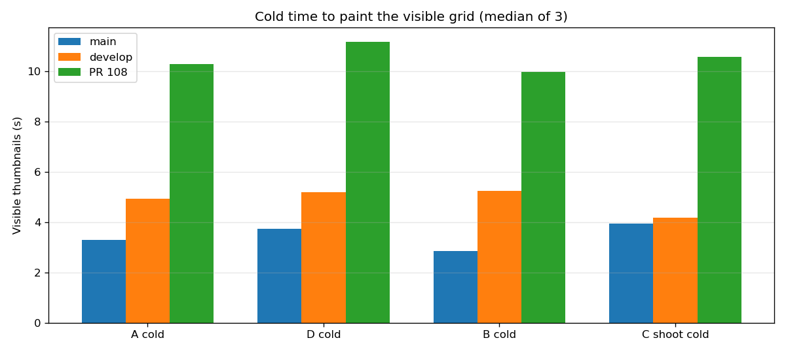
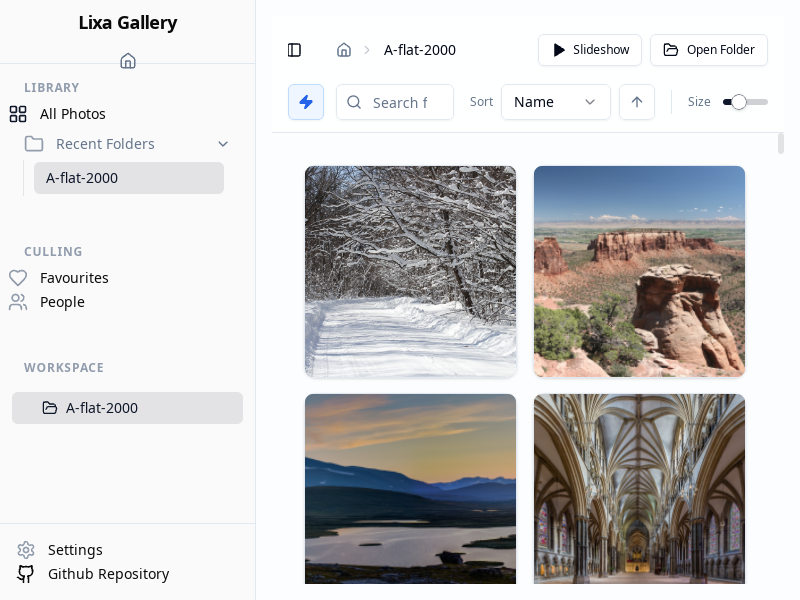
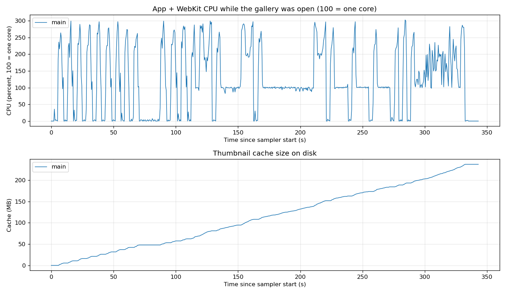

# Real-photo e2e results, 24 Nov 2026

Public record of the harness runs. Images sit next to this file.

## Setup

Harness: [e2e/README.md](../README.md). Release binaries were built with the frontend build, then `cargo build --release --features tauri/custom-protocol` from `src-tauri`. A plain `cargo build --release` still loads the Vite dev server and is not what was timed.

Machine: 4-core Linux VM, WebKitGTK 4.1, tauri-driver under Xvfb. Cold runs called `drop_caches` and used a fresh XDG data directory. Warm runs reopened the same folder in the same process. One run of each scenario per build, except the three-way first-load and switch numbers below, which are medians of 3 runs.

Fixture sets (hardlinks, so names share the page cache until the cold drop):

| Set | Contents |
| --- | --- |
| A | 2,000 large JPEGs, one directory |
| B | about 500 files, RAW+JPEG pairs with the same basename |
| C | nested shoots; `C-nested/shoot-03` is the timed leaf |
| D | 1,000 large JPEGs |
| E | 24 JPEGs reserved for export |

Caveat on the photo bytes. `main` was timed on a later download: 200 unique JPEGs, 4.14 GB, average 20.7 MB. The visible grid on `main` was 16 cells, because the cards are larger. `develop` and [PR #108](https://github.com/santhosh-chinnasamy/lixa-gallery/pull/108) were timed earlier on 61 unique JPEGs, average 20.1 MB, with 26–28 visible cells. Same harness and same folder sizes. Not the same files, and not the same number of on-screen cells.

## Three-way table

Cold "visible" is the median time until every cell in the DOM has a thumbnail or a failure. Switch-back mid-decode is the return to folder A after leaving it while visible thumbnails were still loading (`loadedWhenSwitched` 0 or 1). Fast-flick max is the longest `requestAnimationFrame` gap during the flick.

| | main | develop | PR #108 |
| --- | ---: | ---: | ---: |
| Cold visible grid, A | 3299 ms | 4937 ms | 10288 ms |
| Cold visible grid, D | 3730 ms | 5179 ms | 11173 ms |
| Cold visible grid, B | 2859 ms | 5253 ms | 9970 ms |
| Cold visible grid, C shoot | 3936 ms | 4173 ms | 10571 ms |
| Switch back mid-decode | ~300 ms | ~3 s | ~18 s |
| Fast-flick max frame | 35 ms | 545 ms | 232 ms |
| Viewer, 50 arrows | 32.2 s | 19.9 s | 16.1 s |
| Fast P presses stored, of 200 | n/a | 138 | 182 |

Failed JPEG cells were 0 on all three. C-shoot failed cells were 0 on `main` and 1 on `develop` and #108.







On `main` the sampler's app+WebKit CPU peaked at 303% (100% is one core) and the app RSS peak it recorded was 1351 MB. The thumbnail cache was 237 MB at the end of that shorter run and still climbing. A spot check of `/proc` mid-load saw the app at roughly 180–500 MB and the WebKit process at roughly 330–400 MB, with the app thread count climbing through 80. `develop` and #108 were not sampled the same way: both pegged the four machine cores (sum near 400%) for the whole session, and both thumbnail caches plateaued near 360 MB, with `develop` reaching that plateau sooner.

## PR #142

[PR #142](https://github.com/santhosh-chinnasamy/lixa-gallery/pull/142) is the speedup branch on top of #108. These numbers are one harness run of that branch against the original #108 scheduler build, recorded on the pull request. They were not re-run for this file.

| | #108 scheduler | #142 |
| --- | ---: | ---: |
| Cold visible grid, A | 10361 ms | 3869 ms |
| Cold visible grid, D | 11407 ms | 3986 ms |
| Switch back mid-decode (`loadedWhenSwitched` 0) | 17470 ms | 933 ms |
| Switch back after the first folder had finished | 362 ms | 331 ms |
| Fast-flick max frame | 249 ms | 248 ms |
| Viewer, 50 arrows | 16661 ms | 15506 ms |

A build with only the scheduler and grid edits, before the decode-thread change, stayed at 9895 ms cold on A and 17484 ms on the mid-decode switch. That is the measurement behind the Rayon-pool cause below.

## What was not a failure

- Cached-404 cancel was not reproduced. Switching while decodes were in flight left 0 Failed to load cells on `main`, `develop`, and #108, and the logs had no `cancelled` lines.
- Export copy, move, and cancel were not verified. The GTK folder chooser accepts a pasted path and does not activate Open from xdotool under Xvfb.
- Not on `main`, confirmed in the running app and in the tree: no Dark control on Settings, no keyboard cull (`P` / `X` / `U`), and the scanner in `src-tauri/infra/src/fs_ops.rs` does not list RAW extensions, so CR2/NEF/DNG never enter the grid.

## Causes

Labelled by how they were established.

| Claim | How established |
| --- | --- |
| #108 fills the visible grid slower than `main` and `develop`, and a mid-decode switch-back takes ~18 s | Measured in the app |
| #142 brings cold A/D under 4 s and mid-decode switch-back from ~17 s to ~0.9 s; flick max stays ~250 ms | Measured on that branch (see the table above) |
| Extra scheduler workers did not help until each decode stopped sharing one Rayon thread | Measured: the scheduler-only build stayed near 10 s / 17 s. Read in code on #142: `RayonImageProcessor` was running every `install()` on a one-thread pool, so admitted jobs queued behind a single decode. Decode then moved to `spawn_blocking` |
| `recommended_pool_size()` is `cores/2` and `recommended_background_slots()` is 1; `begin_generation` keeps stale in-flight work inside `max_workers` | Read in `src-tauri/gallery-core/src/work.rs` and `work_scheduler.rs` on #108. The 18 s switch-back is the measured effect |
| `main` has no scheduler. `RayonImageProcessor::new` uses 4 threads and `convert_image` is `image::open` plus `DynamicImage::thumbnail(512, 512)` | Read in `src-tauri/infra/src/image.rs` on `main`. The ~3 s visible time and ~300 ms switch-back are the measured effect |
| Fast `P` stores fewer picks than keypresses (138/200 on `develop`, 182/200 on #108), and a restart keeps that lower count | Measured. The toggle-before-advance explanation is read in `Gallery.svelte` `markActive` and `createCullFlagStore`, not a traced key log |
| A RAW with no embedded JPEG stays on Failed to load, including after a warm reopen | Measured on `develop` and #108 (one cell in C-shoot, log line `No embedded JPEG preview`). The missing retry on the release origin is read in `ImageCard.svelte` `handleImageError`, which retries only when `pageIsHttpOrigin()` is true |
| `mergePhotoUpdates` still copies the photo list, and the grid re-sorts when the list identity changes | Read in `src/stores/galleryStore.ts` and `Gallery.svelte` `processedPhotos`. A 20–45 ms per-batch hitch was not isolated. What was measured is the flick max: 35 ms on `main` (no `photos-updated`), 545 ms on `develop`, 232 ms on #108, and still 248 ms after #142 |
| `{stem}.webp` is shared by every file with that stem on `main` | Read in `convert_image` on `main`. Not checked by comparing pixels. `develop` and #108 key the file by source path plus mtime and size in `thumbnail_disk_path` |

## Fix plan

1. Scheduler admission and the shared decode thread: [#108](https://github.com/santhosh-chinnasamy/lixa-gallery/pull/108) and [#142](https://github.com/santhosh-chinnasamy/lixa-gallery/pull/142). #142 already gets cold A/D under 4 s. Mid-decode switch-back is 933 ms, still over the 500 ms budget, when no thumbnail had been written yet.
2. Flick max frame, still about 250 ms after the list-patch in #142. Next place to look is rendering, not another scheduler change. `mergePhotoUpdates` and the grid sort are the code path; the frame time is the measurement.
3. Fast `P` dropping picks: [#110](https://github.com/santhosh-chinnasamy/lixa-gallery/issues/110). Bind the flag to the photo captured at keydown and ignore a repeat on that photo until the index moves.
4. `U` does nothing on Favourites: [#111](https://github.com/santhosh-chinnasamy/lixa-gallery/issues/111). The shortcut map does not include that page.
5. CI on pull requests into `develop`: [#115](https://github.com/santhosh-chinnasamy/lixa-gallery/issues/115) and [#143](https://github.com/santhosh-chinnasamy/lixa-gallery/pull/143).
6. Turn this harness into a release gate: [#122](https://github.com/santhosh-chinnasamy/lixa-gallery/issues/122), using the budgets below.
7. RAW with no embedded preview: [#119](https://github.com/santhosh-chinnasamy/lixa-gallery/issues/119). Half-size fallback decode, or an explicit unsupported placeholder. Not a `main` bug.

## Proposed budgets

Fail a release run when any of these break, on set A, cold cache, release binary:

| Budget | Limit | Where the current builds sit |
| --- | --- | --- |
| Cold visible grid | < 4 s | `main` 3.3 s, `develop` 4.9 s, #108 10.3 s, #142 3.9 s |
| Mid-decode switch-back | < 500 ms | `main` ~300 ms, `develop` ~3 s, #108 ~18 s, #142 933 ms |
| Fast-flick max frame | < 50 ms | `main` 35 ms, `develop` 545 ms, #108 232 ms, #142 248 ms |
| Viewer, 50 arrows | <= 16 s | `main` 32.2 s, `develop` 19.9 s, #108 16.1 s, #142 15.5 s |

## How to re-run

From the repo root, after each binary is built with `--features tauri/custom-protocol`:

```bash
LIXA_SKIP_FIXTURES=1 \
LIXA_SETS="$PWD/e2e/fixtures/sets" \
LIXA_BIN_PR=/path/to/pr/lixa-gallery \
LIXA_BIN_DEVELOP=/path/to/develop/lixa-gallery \
LIXA_RUNS=3 \
./e2e/run.sh
```

One build only:

```bash
LIXA_BIN=/path/to/lixa-gallery LIXA_BRANCH=main LIXA_RUNS=3 ./e2e/run.sh
```

Omit `LIXA_SKIP_FIXTURES` to download or resume photos first. `LIXA_FIXTURE_CACHE` overrides the cache directory. `LIXA_OUT` overrides `e2e/out`. `LIXA_ONLY` is a comma-separated list of scenario names (`load`, `switch`, `scroll`, `cull`, `favourites`, `viewer`, `settings`). Timings land in `e2e/out/<branch>/results.jsonl`.
